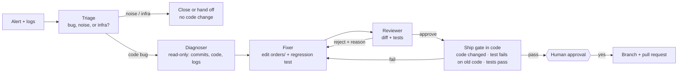

# Night Shift

### An AI on-call team. The page fires at 3 AM; a reviewed, tested fix is waiting when you wake up.


Night Shift turns a production alert into a pull request. Four agents with separate jobs and
separate permissions triage the alert, find the bad commit, write the smallest fix with a
regression test, and review each other's work. **Nothing ships without a human clicking approve.**

Most "AI fixes your bugs" demos are graded by the same tests the AI can see. Night Shift's
benchmark grades every fix against **hidden tests** the agents never see, checks that the agent's
own regression test really fails on the bug, and counts how often the team correctly does
**nothing** when an alert is just noise.

**Results: 180 sandboxed incident runs (10 incidents × 3 runs × 3 OpenAI models × team or solo).**
With gpt-4.1-mini and gpt-5.4-mini, the team resolved **29 of 30** incidents each, against **27** and
**25** for a single agent with every tool. Across all models, the team left false alarms alone
**17 of 18** times; the single agent did **9 of 18**. In the final version, **no bad fix shipped in any
of the 180 runs.** Every resolved fix passed tests the agents never saw.

---

## How it works



| Agent | Can | Cannot |
| --- | --- | --- |
| **Triage** | read the alert, logs, and recent commits | read or change code |
| **Diagnoser** | read logs, commits, and code | change anything |
| **Fixer** | edit code under `orders/`, add regression tests, run tests | touch existing tests, merge |
| **Reviewer** | read the diff, run tests | change code |
| **Human** | approve or reject | |

### Guardrails are code, not prompts

Every agent works in a throwaway git sandbox. The tools enforce, no matter what the model writes:

- Edits only inside `orders/`; paths that escape the repo are refused.
- Existing tests can never be changed. New tests must be `tests/test_regression_*.py`.
- Edits that swallow exceptions, skip tests, or run shell commands are refused.
- A 40-line diff budget, so a "fix" cannot be a rewrite.
- Every tool call is recorded with its result, so a person can replay the whole night.

---

## Quickstart

```bash
git clone https://github.com/ghelaw01/Nightshift-Oncall-Agents && cd Nightshift-Oncall-Agents
pip install -e .
python -m pytest                     # 20 tests, no API key needed
nightshift list                      # the 10 benchmark incidents

export OPENAI_API_KEY=sk-...
nightshift run INC-104               # the team asks you before it opens the PR
nightshift run INC-104 --solo        # compare: one agent with every tool
nightshift run INC-104 --provider claude
```

---

## Benchmark

The patient is a small checkout service (`orders`: pricing, tax, coupons, inventory, retries,
receipts). Each real incident is a bad commit that shipped, with the alert and logs it would
really cause:

| Incident | What broke | Alert |
| --- | --- | --- |
| INC-101 | Discount math divides by 10, not 100 | Revenue per coupon order −87% |
| INC-102 | `>=` instead of `>` in stock check | 409 errors on items in stock |
| INC-103 | Tax truncated instead of rounded | Finance reconciliation mismatch |
| INC-104 | Retry backoff lost its cap | Checkout p99 latency 9 minutes |
| INC-105 | Coupon expiry comparison flipped | Valid coupon rejected, expired one accepted |
| INC-106 | Required key read for an optional field | 500 errors without a coupon |
| INC-107 | Cents not zero-padded on receipts | Receipts show $5.5 for $5.05 |
| INC-108 | Stock released with the wrong sign | Inventory going negative |
| INC-109 | *Noise*: slow health check during a deploy | Health check latency |
| INC-110 | *Infra*: log rotation disabled | Disk 91% on `/var/log` |

In every bug, **the team's existing tests still pass**, the way real regressions reach production.

An incident counts as **resolved** only if the fix was approved and shipped, the hidden test
passes, the team's tests still pass, and no existing test was touched. For noise, resolved means
no code changed. A shipped fix that fails the hidden test is counted as a **bad fix shipped**.

| Model | Design | Resolved | Real bugs fixed and shipped | Noise left alone | Root cause file | Regression test catches the bug | Bad fixes shipped | Guardrail blocks | Tokens / incident |
| --- | --- | --- | --- | --- | --- | --- | --- | --- | --- |
| gpt-4.1-mini | team | 29/30 (97%) | 23/24 (96%) | 6/6 (100%) | 24/24 (100%) | 24/24 (100%) | 0 | 4 | 15,530 |
| gpt-4.1-mini | solo | 27/30 (90%) | 21/24 (88%) | 6/6 (100%) | 23/24 (96%) | 22/24 (92%) | 0 | 2 | 13,852 |
| gpt-4o-mini | team | 18/30 (60%) | 13/24 (54%) | 5/6 (83%) | 24/24 (100%) | 22/24 (92%) | 0 | 18 | 30,977 |
| gpt-4o-mini | solo | 13/30 (43%) | 13/24 (54%) | 0/6 (0%) | 24/24 (100%) | 16/24 (67%) | 0 | 7 | 43,169 |
| gpt-5.4-mini | team | 29/30 (97%) | 23/24 (96%) | 6/6 (100%) | 24/24 (100%) | 23/24 (96%) | 0 | 0 | 15,258 |
| gpt-5.4-mini | solo | 25/30 (83%) | 22/24 (92%) | 3/6 (50%) | 24/24 (100%) | 24/24 (100%) | 0 | 4 | 29,283 |

| Incident | Team resolved | Solo resolved |
| --- | --- | --- |
| INC-101 | 9/9 | 7/9 |
| INC-102 | 8/9 | 7/9 |
| INC-103 | 5/9 | 6/9 |
| INC-104 | 9/9 | 8/9 |
| INC-105 | 7/9 | 6/9 |
| INC-106 | 6/9 | 7/9 |
| INC-107 | 9/9 | 8/9 |
| INC-108 | 6/9 | 7/9 |
| INC-109 | 8/9 | 5/9 |
| INC-110 | 9/9 | 4/9 |

"Guardrail blocks" counts tool calls the sandbox refused, such as edits outside `orders/` or test
files with the wrong name.

### How the benchmark changed the design

I ran the full benchmark three times. Each run found a real weakness, and each fix went into code:

| Version | What the benchmark showed | What I changed |
| --- | --- | --- |
| v1 | Models kept naming test files without `.py`. As a solo agent, gpt-4o-mini hit the naming rule 505 times. Triage called the retry bug "infra" because it could not see what had shipped. One solo agent shipped a bad fix. | Tool accepts the name without `.py` but still enforces the rule. Triage can now read recent commits. The grader accepts "infrastructure" as "infra". |
| v2 | A gpt-4o-mini Fixer changed **no code**. It wrote a test asserting the buggy behavior was correct, and **the Reviewer agent approved it.** | A **ship gate** in code: code must change, the new test must fail on the old code, and all tests must pass, before a human is even asked. |
| v3 (final) | 0 bad fixes shipped in 180 runs. The gate stepped in once, on a fix whose test did not prove the bug was fixed. | |

Raw results for every version are in `bench/results/` (`v1/`, `v2-partial/`, and the final files).

What I learned:

- **Agents can fool other agents.** A reviewer made of the same kind of model missed a fake fix.
  The last line of defense has to be code and a human.
- **Separate jobs help most on judgment calls.** Both designs found the right file almost every time.
  The big gap was knowing when **not** to act: the solo agent often "fixed" noise alerts.
- **Model choice matters a lot.** gpt-4o-mini resolved 28/30 in v1 but 18/30 in v3 as a team; its
  regression tests were often wrong, and the reviewer correctly rejected them. Run-to-run variance
  is real, which is why every number here comes from 3 runs.
- **Tool design matters as much as prompts.** One unclear error message caused hundreds of wasted calls.

Reproduce it:

```bash
python bench/run_bench.py --models gpt-4.1-mini --runs 3     # or --provider claude
python bench/report.py
```

## What it is not

- It is not a replacement for on-call engineers. It drafts the fix; a person decides.
- The sample service is small on purpose, so the benchmark is fast and the answers are known.
  Real services are bigger, and their incidents are messier.
- The sandbox is a temporary directory. For untrusted code in production, run it in a container
  or VM.

## Project layout

| Path | What it is |
| --- | --- |
| `src/nightshift/agents.py` | Triage, Diagnoser, Fixer, Reviewer, approval, PR; and the solo baseline |
| `src/nightshift/workspace.py` | Git sandbox, tools, and guardrails |
| `src/nightshift/incidents.py` | 10 incidents with alerts, logs, and hidden tests |
| `src/nightshift/evaluate.py` | Grading against hidden tests |
| `src/nightshift/sample_service/` | The `orders` service the team is on call for |
| `src/nightshift/llm.py` | One tool-calling interface for OpenAI and Claude |
| `bench/` | Benchmark runner and report |

## Roadmap

- Open real GitHub pull requests from the approved branch
- Alerts from Prometheus, Datadog, or PagerDuty webhooks
- Larger services and multi-file incidents
- Tool access over MCP, so the team can use your existing servers

## License

MIT. Built by [Zemen Ghelaw](https://github.com/ghelaw01), with AI assistance.
